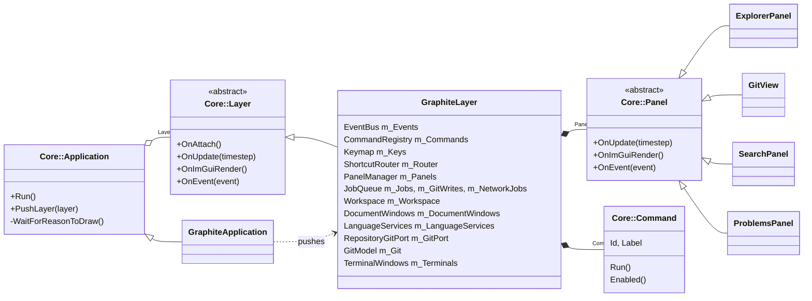
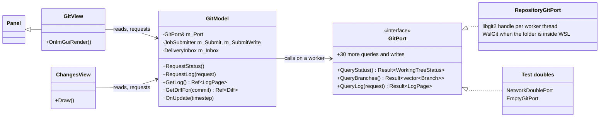
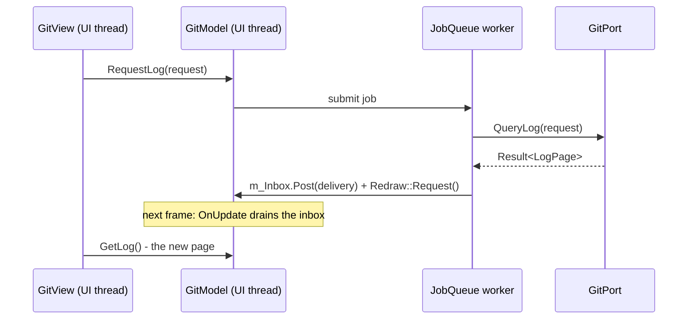
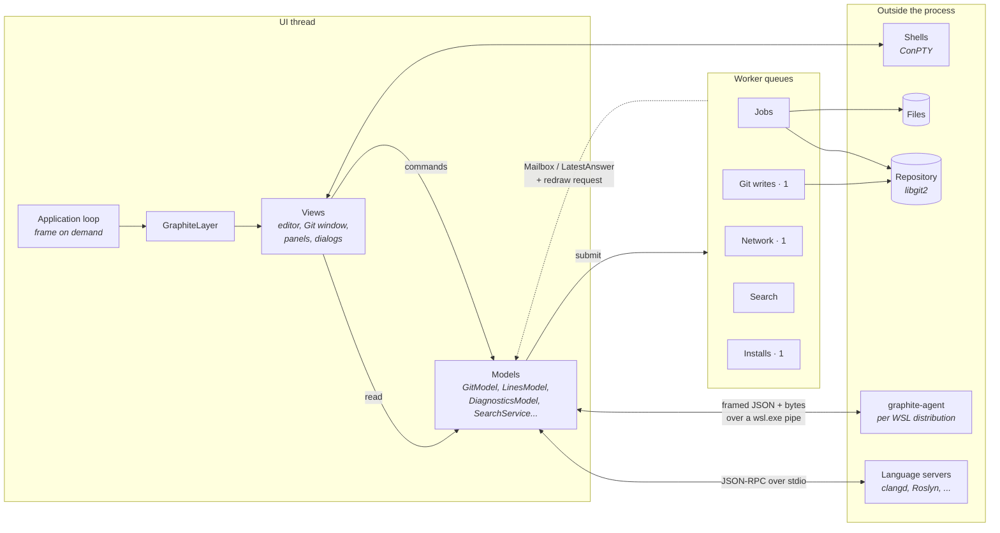

<p align="center">
  
</p>

<h1 align="center">Graphite</h1>

<p align="center">
  A fast, native, cross-platform IDE for C++ and C#, built on Dear ImGui.
</p>

<p align="center">
  
  
  
  
</p>

<picture>
  <source media="(prefers-color-scheme: light)" srcset="docs/images/editor-light.png">
  
</picture>

## Contents

- [Performance](#performance)
- [Features](#features)
- [Screenshots](#screenshots)
- [Platform support](#platform-support)
- [Getting started](#getting-started)
- [Running the tests](#running-the-tests)
- [Architecture](#architecture)
- [Keyboard shortcuts](#keyboard-shortcuts)
- [Roadmap](#roadmap)
- [Third-party software](#third-party-software)
- [License](#license)

## Performance

Graphite is built to stay responsive on large codebases and large repositories, and to cost nothing while it waits.

- **Native code** - C++20 on Dear ImGui, with no browser engine or managed runtime behind the interface.
- **No work while idle** - a frame is drawn only for input, a finished background task or a running animation; an
  idle window draws nothing ([ADR 0530](docs/adr/0530-draw-a-frame-only-when-there-is-reason-to.md)).
- **A UI thread that never waits** - disk, Git, language servers, search and the system file dialog run on worker
  queues and hand their results back between frames.
- **Large repositories** - history is read 500 commits at a time and drawn only where it is on screen; status, branch
  lists and diffs are read in the background with one repository handle per worker.
- **Large files** - binary files of any size open in the hex viewer, which reads them in 64 KiB blocks as they
  scroll into view.

## Features

### Editor

- **Language support** - highlighting, diagnostics, hover, go to definition, find references and reference counts
  above declarations, through the Language Server Protocol.
- **Language servers** - clangd for C++; Roslyn, csharp-ls or OmniSharp for C#. Chosen per language in Settings,
  downloaded on first use and verified by SHA-256 before they run.
- **Editing** - find and replace, moving and duplicating lines, line comments, configurable indentation and line
  endings for new files.
- **Line history** - inline blame for the current line and change markers in the gutter and scrollbar.
- **Crash recovery** - unsaved buffers are copied aside as you type and restored after an abnormal exit; saves are
  atomic.

### Navigation

- **Command Palette** - every enabled command, found by a few letters of its label.
- **Go to File, Go to Line, Go to Definition** - with Back and Forward across all of them.
- **Explorer** - folder tree with Git status, cut, copy, paste and drag-and-drop; a solution view that reads
  `.sln`, `.slnx`, `.vcxproj` and `.csproj`.
- **Search** - find in files, a Problems list and a references panel.

### Git

- **History** - every commit with its graph, or first parents only, loaded 500 commits at a time so large
  repositories open at once.
- **Branches, tags, stashes and worktrees** - in one sidebar, with the commits not yet pushed marked in the history.
- **Changes** - staging, diffs side by side or inline, commits, amend, fetch, pull and push.
- **Branch review** - a branch compared with its base the way a pull request would be, with files marked as viewed.

### WSL

- **Folders inside a distribution** - opened through `graphite-agent`, a small helper Graphite installs into the
  distribution: files are read, watched and saved there, and Git status, staging, history and branches run there
  too.

### Workspace

- **Terminals** - for every installed shell, with search in the scrollback.
- **Viewers** - images and a hex view for files that are not text.
- **Appearance** - built-in light and dark themes, themes loaded from JSON, interface scaling and rebindable
  shortcuts.
- **Claude Code sessions** - a panel for browsing session transcripts and what they cost.

## Screenshots

<details open>
<summary><b>Git window</b> - history graph, branches, tags, a stash, commits not yet pushed and a diff</summary>


</details>

<details>
<summary><b>Branch review</b> - a branch against its base, with files marked as viewed</summary>


</details>

<details>
<summary><b>Diff</b> - uncommitted changes side by side</summary>


</details>

<details>
<summary><b>Command Palette</b> - every command by a few letters of its name</summary>


</details>

<details>
<summary><b>Find in Files</b></summary>


</details>

<details>
<summary><b>Solution view</b> - a Visual Studio solution's projects and folders</summary>


</details>

<details>
<summary><b>Image viewer</b></summary>


</details>

<details>
<summary><b>Hex viewer</b> - for files that are not text</summary>


</details>

<details>
<summary><b>Themes</b> - the editor in Gruvbox Dark, the built-in themes and the colour editor</summary>


</details>

<details>
<summary><b>Key bindings</b> - every shortcut rebindable, with where it applies</summary>


</details>

## Platform support

| Platform | Status |
|---|---|
| Windows 10 and 11 (x64) | Supported |
| Linux | In progress - the core libraries build and pass their tests; the interface is not ported yet |
| macOS | Planned |

Folders inside WSL are supported from the Windows build.

## Getting started

Projects are generated by [premake](https://premake.github.io), which is checked in, and every dependency is a git
submodule built from source. On Windows the application is compiled with MSVC; the Visual Studio IDE itself is
optional.

### Prerequisites

- Windows 10 or 11 (x64)
- The MSVC toolset from **Visual Studio 2026** (the *Desktop development with C++* workload) or from **Build Tools
  for Visual Studio 2026**
- Git

### Building

```powershell
git clone --recursive https://github.com/CaptainLost/graphite-ide.git
cd graphite-ide
.\vendor\bin\premake\premake5.exe vs2026
msbuild Graphite\Graphite.vcxproj -p:Configuration=Release -p:Platform=x64 -m -nodeReuse:false
```

`msbuild` is on the path in a Developer PowerShell; elsewhere it is in `MSBuild\Current\Bin` under the Visual Studio
or Build Tools installation. With the IDE, open `Graphite.slnx` and build the `Graphite` project instead.

Premake collects sources by globbing, so it has to run again after a source file is added or removed.

### Running

The executable is written to `bin\<configuration>-windows-x86_64\Graphite\`. A folder to open can be passed on the
command line:

```powershell
.\bin\Release-windows-x86_64\Graphite\Graphite.exe D:\path\to\project
```

### Linux

The parts of Core that already build for Linux, and the WSL agent built on them, are cross-compiled from Windows by a
pinned [zig](https://ziglang.org), so no Linux machine is needed to build them; the commands are under
[Running the tests](#running-the-tests). The interface does not build for Linux yet.

## Running the tests

Two doctest suites cover the engine (`CoreTests`) and the application (`GraphiteTests`):

```powershell
msbuild Core\tests\CoreTests.vcxproj -p:Configuration=Debug -p:Platform=x64 -m -nodeReuse:false
.\bin\Debug-windows-x86_64\CoreTests\CoreTests.exe

msbuild Graphite\tests\GraphiteTests.vcxproj -p:Configuration=Debug -p:Platform=x64 -m -nodeReuse:false
.\bin\Debug-windows-x86_64\GraphiteTests\GraphiteTests.exe
```

The Linux part of Core and the WSL helper are cross-compiled from Windows with a pinned zig and tested inside WSL:

```powershell
.\scripts\Get-Zig.ps1                                 # once: downloads zig and checks its SHA-256
.\vendor\bin\zig\zig.exe build -Dconfiguration=Debug
.\scripts\Test-CoreLinux.ps1                          # skipped when WSL is not available
```

## Architecture

The code is in two layers. **Core** (`Core/src/Core/<Module>`) is a general-purpose application engine: the window
and main loop, layers, panels, events, jobs, commands and key bindings, documents and text, file watching, Git, terminals,
the WSL agent protocol and the ImGui widgets. It has no knowledge of the IDE built on it. **GraphiteLib**
(`Graphite/src/<Feature>`) is the IDE, one folder per feature, built as a static library that both `Graphite.exe` and
`GraphiteTests` link. `graphite-agent` (`Agent/src`) is a separate Linux program built on part of Core.

### Composition

Features are not looked up through globals or a service locator. `Main.cpp` creates the application and pushes one
layer; `GraphiteLayer` is the composition root that owns every model, port, view and worker queue as a member and
hands each one exactly the collaborators it needs through its constructor.



- **Layers** receive the frame (`OnUpdate`, `OnImGuiRender`) and input (`OnEvent`) from `Core::Application`.
- **Panels** are dockable windows; `PanelManager` draws them, remembers their placement and gives each a menu entry
  and a toggle command.
- **Commands** are named actions in a `CommandRegistry`; menus, the Command Palette and key bindings all run the same
  command, and `ShortcutRouter` turns key presses into commands through the `Keymap`.
- **Events** cross features through a typed `EventBus` (`Subscribe<T>`, `Publish<T>`), so a feature that asks for a
  file to open or a commit to be shown does not depend on the one that does it.

### Anatomy of a feature

Every feature that does slow work is built the same way: a **port** for the outside world, a **model** that owns the
state, and **views** that draw it. The Git feature, the largest, is the example.



A request goes through the same five steps whichever feature makes it:



- **Ports** (`GitPort`, `BlamePort`, `LinesPort`, `ReviewPort` and the language services' document ports) are abstract
  classes. The production implementation picks a local libgit2 repository or the WSL agent by the folder's path; the
  tests pass a double.
- **Models** keep slow work off the UI thread. Each `Request…` submits a job through a `JobSubmitter` and returns; the
  job's result comes back through a `DeliveryInbox`, `Mailbox` or `LatestAnswer` and is applied on the UI thread in
  `OnUpdate`. A model given `[](std::function<void()> job) { job(); }` as its submitter runs synchronously, which is
  how the tests drive it.
- **Views** keep only view state such as selection, scroll and layout: they read a model's `Get…` results each
  frame and call its `Request…` or write methods.

### Inside the running IDE



- **One UI thread owns all state.** Views read models and send them commands; nothing on a worker touches a model.
- **Writes are serialised.** Git writes and network operations each have a single worker, so two never race on one
  repository.

Design principles:

- **Frames on demand** - a frame is drawn only for input, a finished background task or a running animation, so an
  idle window uses no CPU.
- **Nothing slow on the UI thread** - Git queries, solution parsing, language servers and the system file dialog run
  on workers; each Git worker keeps its own repository handle.
- **Errors as values** - functions that can fail return `Result<T>` rather than throw across module boundaries.
- **Atomic saves** - a file on disk is always either its old or its new version.

The reasoning behind these and about 700 other decisions is recorded in [`docs/adr`](docs/adr/README.md).

## Keyboard shortcuts

| Action | Shortcut |
|---|---|
| Command Palette | `Ctrl+Shift+P` |
| Go to File | `Ctrl+P` |
| Go to Line | `Ctrl+G` |
| Go to Definition / Find References | `F12` / `Shift+F12` |
| Back / Forward | `Alt+Left` / `Alt+Right` |
| Switch between header and source | `Alt+O` |
| Find / Replace | `Ctrl+F` / `Ctrl+H` |
| Find in Files | `Ctrl+Shift+F` |
| Move lines / Duplicate lines | `Alt+Up`, `Alt+Down` / `Shift+Alt+Down` |
| Toggle line comment | `Ctrl+/` |
| New terminal | ``Ctrl+` `` |

Every shortcut can be rebound in Settings.

## Roadmap

- [x] Editing, navigation and language servers for C++ and C#
- [x] Git: history, branches, staging, review and remotes
- [x] Folders inside WSL: files, watching and Git
- [ ] Build, run and debug from inside the IDE, for C++ and C#/.NET
- [ ] WSL: search, terminals and language servers inside the distribution
- [ ] Builds with compilers other than MSVC, and project files for more than Visual Studio
- [ ] The interface on Linux
- [ ] macOS

## Third-party software

[Dear ImGui](https://github.com/ocornut/imgui) (docking branch),
[GLFW](https://github.com/glfw/glfw),
[libgit2](https://github.com/libgit2/libgit2),
[tree-sitter](https://github.com/tree-sitter/tree-sitter),
[nlohmann/json](https://github.com/nlohmann/json),
[pugixml](https://github.com/zeux/pugixml),
[spdlog](https://github.com/gabime/spdlog),
[ImPlot](https://github.com/epezent/implot),
[ImAnim](https://github.com/soufianekhiat/ImAnim),
[imspinner](https://github.com/dalerank/imspinner),
[miniz](https://github.com/richgel999/miniz),
[stb](https://github.com/nothings/stb) and
[doctest](https://github.com/doctest/doctest).
The interface uses the Inter and JetBrains Mono typefaces and Lucide icons. Their licences are in
[THIRD_PARTY_NOTICES.txt](THIRD_PARTY_NOTICES.txt).

## License

No license has been chosen yet; all rights are reserved for now.
