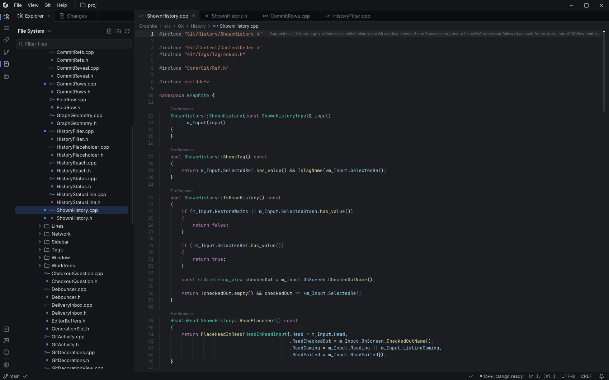

# Graphite

Graphite is an IDE for Windows, written in C++20 on top of Dear ImGui. It is aimed at
C++ and C# projects: it opens a folder or a Visual Studio solution, gets its language
features from clangd or Roslyn, and has a Git client built into the main window.



It is a personal project and still early. Editing, code navigation and Git work;
building, running and debugging from inside the IDE are not there yet.

## Features

- Editor with C++ and C# highlighting, diagnostics, hover, go to definition, find
  references and code lenses, all through the Language Server Protocol.
- clangd for C++; Roslyn, csharp-ls or OmniSharp for C#. The server is picked per
  language in Settings and downloaded on first use.
- Git: history, branches, tags, stashes and worktrees, diffs, staging and commits,
  fetch/pull/push. A branch can be reviewed against its base the way a pull request
  would be, with files marked as viewed.
- Line blame in the editor and change markers in the gutter.
- Folder explorer and a solution view that reads `.sln`, `.slnx`, `.vcxproj` and
  `.csproj`.
- Find in files, a problems list, and terminals for whichever shells are installed.
- Image and hex viewers for files that are not text.
- Colour schemes, including themes loaded from JSON, and rebindable shortcuts.
- A panel for browsing Claude Code session transcripts and what they cost.

## How it is put together

The code is two projects. `Core` is a general-purpose application layer: the window and
main loop, commands, background jobs, file watching, a libgit2 wrapper, a pseudo-console
terminal, text storage and the ImGui widgets. It does not know it is part of an IDE.
`Graphite` is the IDE itself, one folder per feature, built as a static library so the
tests can link exactly what the executable links.

A few choices that shape most of the code:

- ImGui normally redraws every frame. Graphite only draws one when input arrives,
  a background task finishes or an animation is running, so the idle window costs
  nothing.
- Anything that can take a while, from Git queries and solution parsing to language
  servers and even the system file dialog, runs off the UI thread. Each Git worker
  keeps its own libgit2 repository handle.
- Functions that can fail return `Result<T>` instead of throwing across module
  boundaries.
- Saves go through `ReplaceFileW`, so a file on disk is either the old version or the
  new one. Unsaved buffers are copied aside a second or so after typing stops, and
  come back on the next launch if the IDE crashed.
- Language servers are downloaded from their own release pages (GitHub or NuGet) and
  checked against a SHA-256 before they are run.

The reasoning behind these, and many smaller decisions, is written down in
[`docs/adr`](docs/adr/README.md).

## Building

You need Windows 10 or 11 (x64) and Visual Studio 2026 with the "Desktop development
with C++" workload. Everything else is in the repository: dependencies are git
submodules built from source, and premake is checked in.

```powershell
git clone --recursive https://github.com/CaptainLost/graphite-ide.git
cd graphite-ide
.\vendor\bin\premake\premake5.exe vs2026
```

Then open `Graphite.slnx` and build the `Graphite` project. The executable ends up in
`bin\<configuration>-windows-x86_64\Graphite\`. You can pass it a folder to open:

```powershell
.\bin\Release-windows-x86_64\Graphite\Graphite.exe D:\path\to\project
```

Premake picks up source files by globbing, so run it again after adding or removing a
file.

## Tests

There are two doctest suites, `CoreTests` and `GraphiteTests`, each its own project in
the solution. Build either one and run the resulting executable from
`bin\Debug-windows-x86_64\`.

## Dependencies

[Dear ImGui](https://github.com/ocornut/imgui) (docking branch),
[GLFW](https://github.com/glfw/glfw),
[libgit2](https://github.com/libgit2/libgit2),
[tree-sitter](https://github.com/tree-sitter/tree-sitter),
[nlohmann/json](https://github.com/nlohmann/json),
[pugixml](https://github.com/zeux/pugixml),
[spdlog](https://github.com/gabime/spdlog),
[ImPlot](https://github.com/epezent/implot),
[ImAnim](https://github.com/soufianekhiat/ImAnim),
[imspinner](https://github.com/dalerank/imspinner),
[miniz](https://github.com/richgel999/miniz),
[stb](https://github.com/nothings/stb) and
[doctest](https://github.com/doctest/doctest).
The interface uses Inter, JetBrains Mono and Lucide icons. Their licences are in
[THIRD_PARTY_NOTICES.txt](THIRD_PARTY_NOTICES.txt).

## License

No license yet; all rights reserved for now.
