<p align="center">
  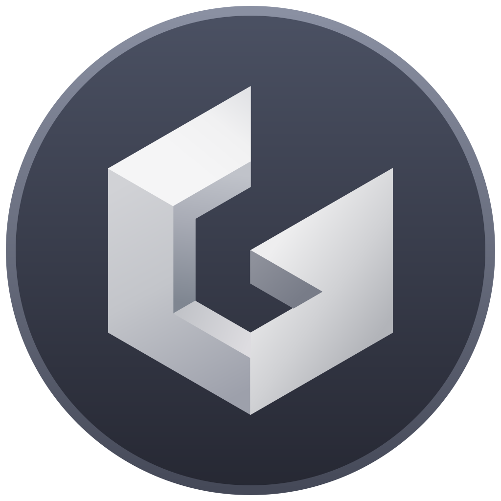
</p>

<h1 align="center">Graphite</h1>

<p align="center">
  A native, cross-platform IDE for C++ and C#, built on Dear ImGui.
</p>

<p align="center">
  
  
  
  
</p>

<picture>
  <source media="(prefers-color-scheme: light)" srcset="docs/images/editor-light.png">
  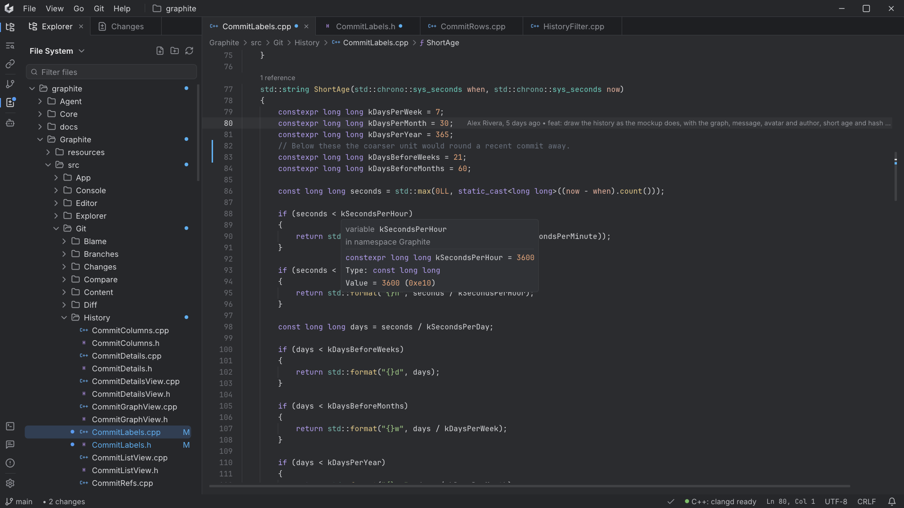
</picture>

## Contents

- [Features](#features)
- [Screenshots](#screenshots)
- [Platform support](#platform-support)
- [Getting started](#getting-started)
- [Running the tests](#running-the-tests)
- [Architecture](#architecture)
- [Keyboard shortcuts](#keyboard-shortcuts)
- [Roadmap](#roadmap)
- [Third-party software](#third-party-software)
- [License](#license)

## Features

### Editor

- **Language support** - highlighting, diagnostics, hover, go to definition, find references and reference counts
  above declarations, through the Language Server Protocol.
- **Language servers** - clangd for C++; Roslyn, csharp-ls or OmniSharp for C#. Chosen per language in Settings,
  downloaded on first use and verified by SHA-256 before they run.
- **Editing** - find and replace, moving and duplicating lines, line comments, configurable indentation and line
  endings for new files.
- **Line history** - inline blame for the current line and change markers in the gutter and scrollbar.
- **Crash recovery** - unsaved buffers are copied aside as you type and restored after an abnormal exit; saves are
  atomic.

### Navigation

- **Command Palette** - every enabled command, found by a few letters of its label.
- **Go to File, Go to Line, Go to Definition** - with Back and Forward across all of them.
- **Explorer** - folder tree with Git status, cut, copy, paste and drag-and-drop; a solution view that reads
  `.sln`, `.slnx`, `.vcxproj` and `.csproj`.
- **Search** - find in files, a Problems list and a references panel.

### Git

- **History** - every commit with its graph, or first parents only, loaded 500 commits at a time so large
  repositories open at once.
- **Branches, tags, stashes and worktrees** - in one sidebar, with the commits not yet pushed marked in the history.
- **Changes** - staging, diffs side by side or inline, commits, amend, fetch, pull and push.
- **Branch review** - a branch compared with its base the way a pull request would be, with files marked as viewed.

### WSL

- **Folders inside a distribution** - opened through `graphite-agent`, a small helper Graphite installs into the
  distribution: files are read, watched and saved there, and Git status, staging, history and branches run there
  too.

### Workspace

- **Terminals** - for every installed shell, with search in the scrollback.
- **Viewers** - images and a hex view for files that are not text.
- **Appearance** - built-in light and dark themes, themes loaded from JSON, interface scaling and rebindable
  shortcuts.
- **Claude Code sessions** - a panel for browsing session transcripts and what they cost.

## Screenshots

<details open>
<summary><b>Git window</b> - history graph, branches, tags, a stash, commits not yet pushed and a diff</summary>

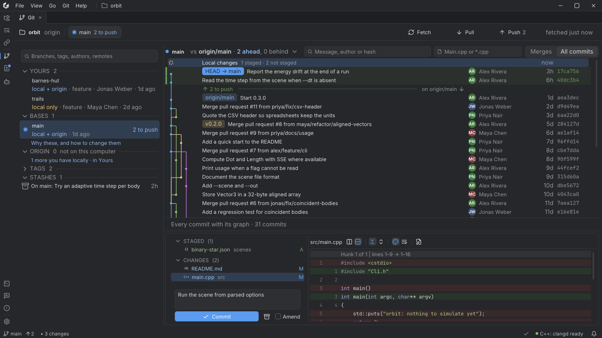

</details>

<details>
<summary><b>Branch review</b> - a branch against its base, with files marked as viewed</summary>

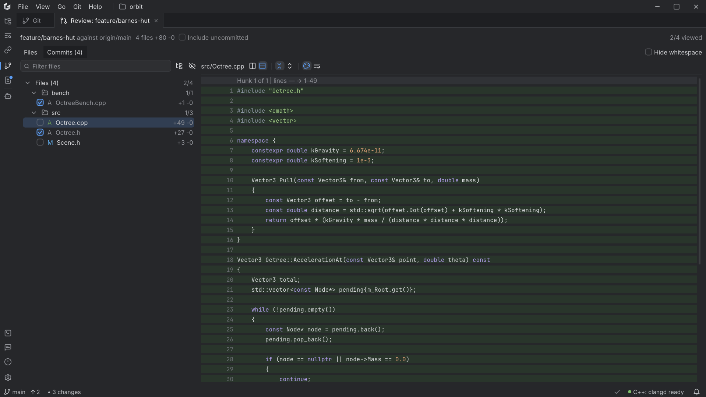

</details>

<details>
<summary><b>Diff</b> - uncommitted changes side by side</summary>

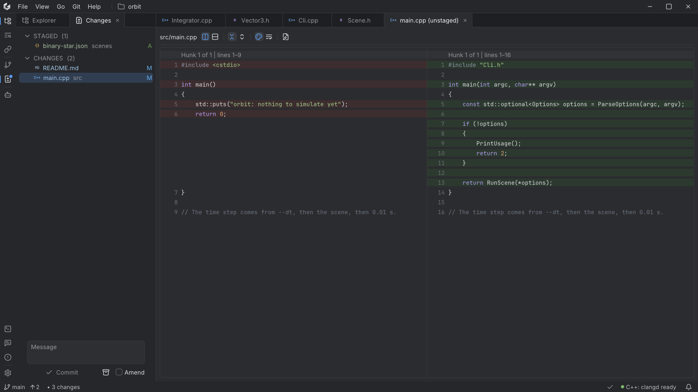

</details>

<details>
<summary><b>Command Palette</b> - every command by a few letters of its name</summary>

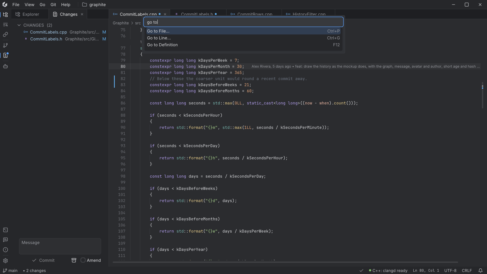

</details>

<details>
<summary><b>Find in Files</b></summary>

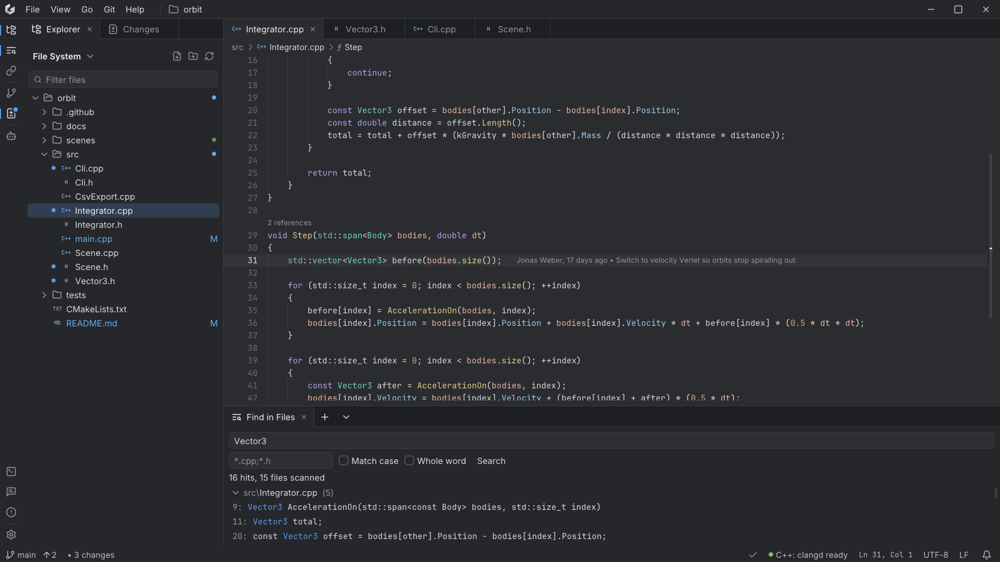

</details>

<details>
<summary><b>Solution view</b> - a Visual Studio solution's projects and folders</summary>

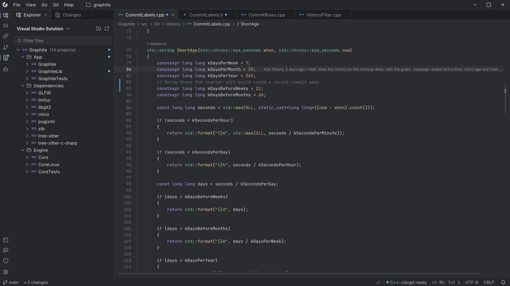

</details>

<details>
<summary><b>Image viewer</b></summary>

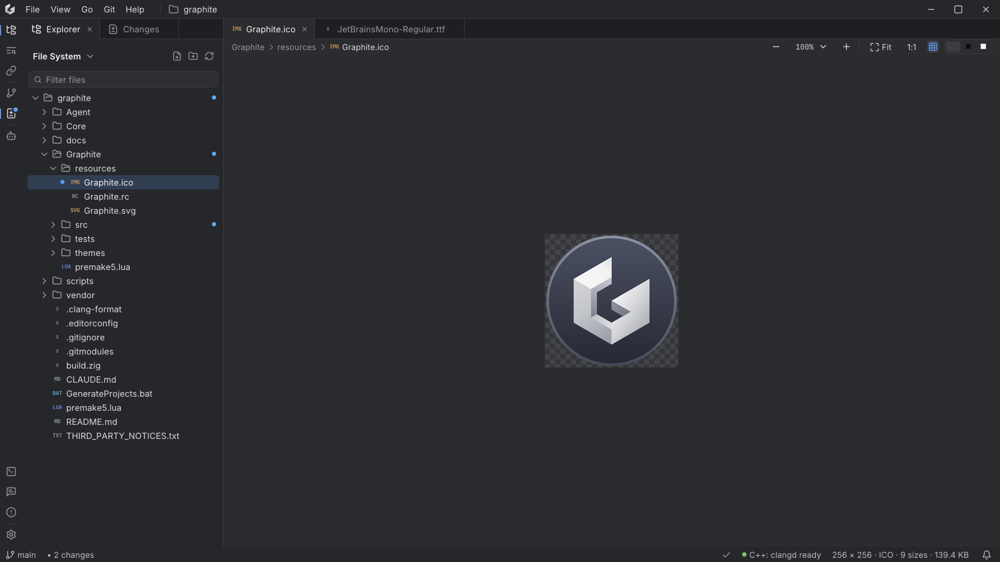

</details>

<details>
<summary><b>Hex viewer</b> - for files that are not text</summary>

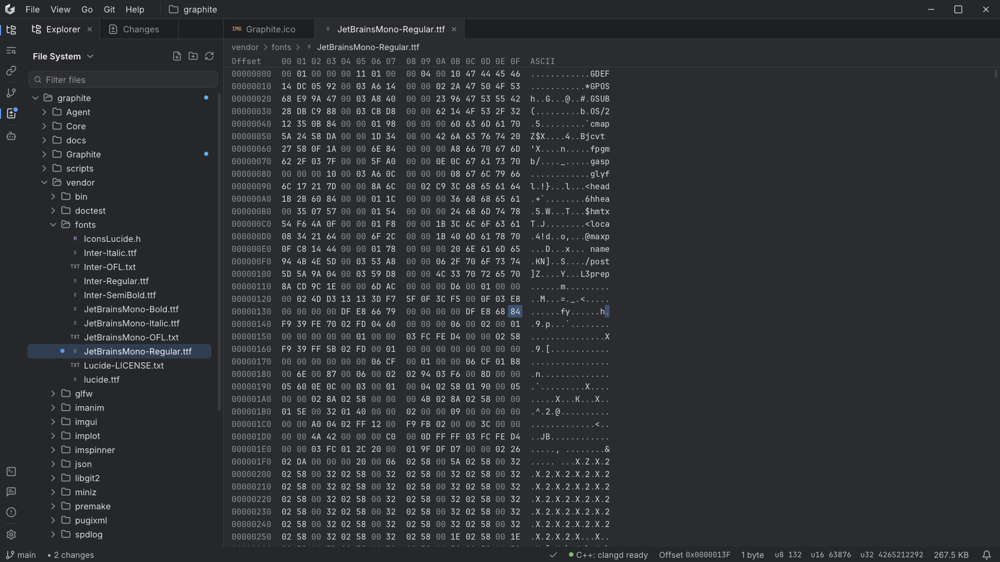

</details>

<details>
<summary><b>Themes</b> - the editor in Gruvbox Dark, the built-in themes and the colour editor</summary>

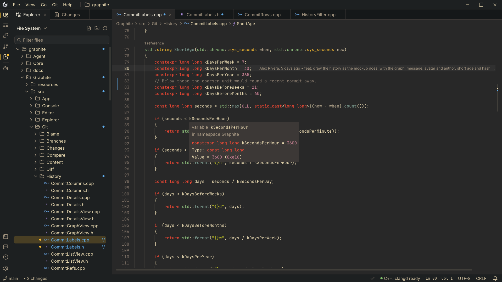

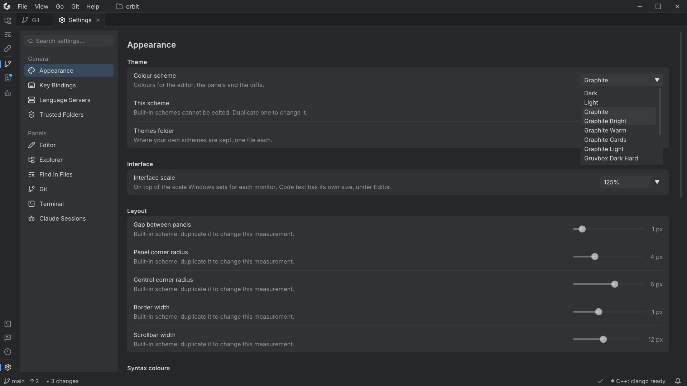

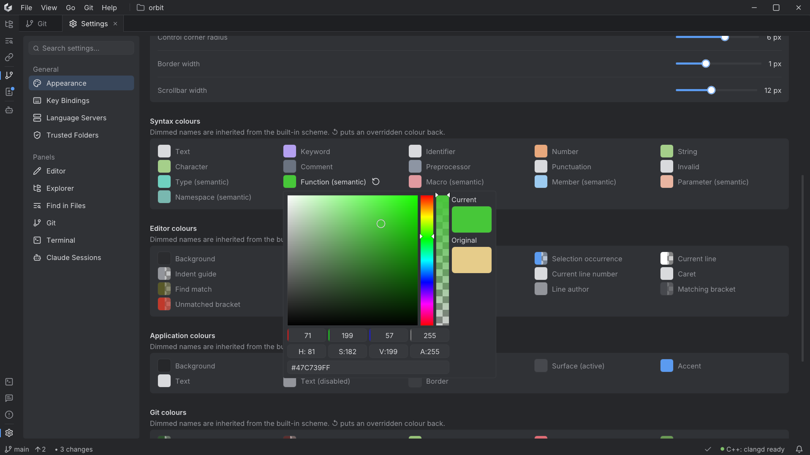

</details>

<details>
<summary><b>Key bindings</b> - every shortcut rebindable, with where it applies</summary>

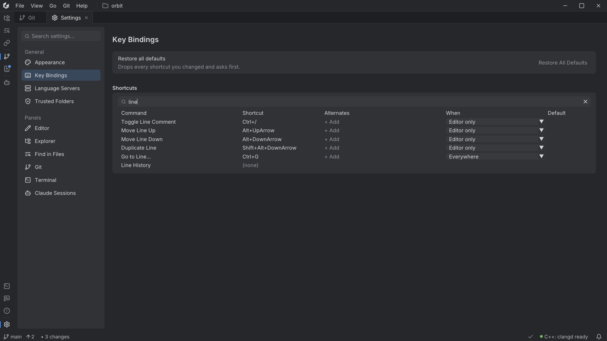

</details>

## Platform support

| Platform | Status |
|---|---|
| Windows 10 and 11 (x64) | Supported |
| Linux | In progress - the core libraries build and pass their tests; the interface is not ported yet |
| macOS | Planned |

Folders inside WSL are supported from the Windows build.

## Getting started

### Prerequisites

- Windows 10 or 11 (x64)
- Visual Studio 2026 with the **Desktop development with C++** workload
- Git

Every other dependency is a git submodule built from source, and premake is checked in.

### Building

```powershell
git clone --recursive https://github.com/CaptainLost/graphite-ide.git
cd graphite-ide
.\vendor\bin\premake\premake5.exe vs2026
```

Open `Graphite.slnx` and build the `Graphite` project, or build from the command line:

```powershell
& 'C:\Program Files\Microsoft Visual Studio\18\Community\MSBuild\Current\Bin\MSBuild.exe' `
    Graphite\Graphite.vcxproj -p:Configuration=Release -p:Platform=x64 -m -nodeReuse:false
```

Premake collects sources by globbing, so it has to run again after a source file is added or removed.

### Running

The executable is written to `bin\<configuration>-windows-x86_64\Graphite\`. A folder to open can be passed on the
command line:

```powershell
.\bin\Release-windows-x86_64\Graphite\Graphite.exe D:\path\to\project
```

## Running the tests

Two doctest suites cover the engine (`CoreTests`) and the application (`GraphiteTests`):

```powershell
$msbuild = 'C:\Program Files\Microsoft Visual Studio\18\Community\MSBuild\Current\Bin\MSBuild.exe'

& $msbuild Core\tests\CoreTests.vcxproj -p:Configuration=Debug -p:Platform=x64 -m -nodeReuse:false
.\bin\Debug-windows-x86_64\CoreTests\CoreTests.exe

& $msbuild Graphite\tests\GraphiteTests.vcxproj -p:Configuration=Debug -p:Platform=x64 -m -nodeReuse:false
.\bin\Debug-windows-x86_64\GraphiteTests\GraphiteTests.exe
```

The Linux part of Core and the WSL helper are cross-compiled from Windows with a pinned zig and tested inside WSL:

```powershell
.\scripts\Get-Zig.ps1                                 # once: downloads zig and checks its SHA-256
.\vendor\bin\zig\zig.exe build -Dconfiguration=Debug
.\scripts\Test-CoreLinux.ps1                          # skipped when WSL is not available
```

## Architecture

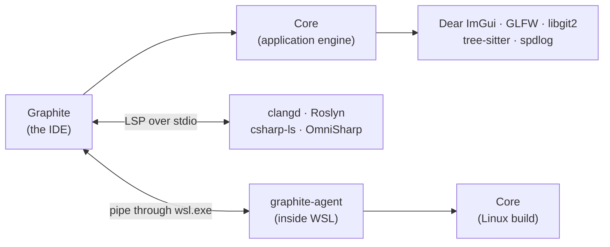

- **Core** is a general-purpose application layer: the window and main loop, commands, background jobs, file
  watching, a libgit2 wrapper, a pseudo-console terminal, text storage and the ImGui widgets. It has no knowledge of
  the IDE built on it.
- **Graphite** is the IDE, one folder per feature, built as a static library that both the executable and the tests
  link.
- **graphite-agent** answers file, watch and Git requests inside a WSL distribution.

Design principles:

- **Frames on demand** - a frame is drawn only for input, a finished background task or a running animation, so an
  idle window uses no CPU.
- **Nothing slow on the UI thread** - Git queries, solution parsing, language servers and the system file dialog run
  on workers; each Git worker keeps its own repository handle.
- **Errors as values** - functions that can fail return `Result<T>` rather than throw across module boundaries.
- **Atomic saves** - a file on disk is always either its old or its new version.

The reasoning behind these and about 700 other decisions is recorded in [`docs/adr`](docs/adr/README.md).

## Keyboard shortcuts

| Action | Shortcut |
|---|---|
| Command Palette | `Ctrl+Shift+P` |
| Go to File | `Ctrl+P` |
| Go to Line | `Ctrl+G` |
| Go to Definition / Find References | `F12` / `Shift+F12` |
| Back / Forward | `Alt+Left` / `Alt+Right` |
| Switch between header and source | `Alt+O` |
| Find / Replace | `Ctrl+F` / `Ctrl+H` |
| Find in Files | `Ctrl+Shift+F` |
| Move lines / Duplicate lines | `Alt+Up`, `Alt+Down` / `Shift+Alt+Down` |
| Toggle line comment | `Ctrl+/` |
| New terminal | ``Ctrl+` `` |

Every shortcut can be rebound in Settings.

## Roadmap

- [x] Editing, navigation and language servers for C++ and C#
- [x] Git: history, branches, staging, review and remotes
- [x] Folders inside WSL: files, watching and Git
- [ ] Build, run and debug from inside the IDE, for C++ and C#/.NET
- [ ] WSL: search, terminals and language servers inside the distribution
- [ ] The interface on Linux
- [ ] macOS

## Third-party software

[Dear ImGui](https://github.com/ocornut/imgui) (docking branch),
[GLFW](https://github.com/glfw/glfw),
[libgit2](https://github.com/libgit2/libgit2),
[tree-sitter](https://github.com/tree-sitter/tree-sitter),
[nlohmann/json](https://github.com/nlohmann/json),
[pugixml](https://github.com/zeux/pugixml),
[spdlog](https://github.com/gabime/spdlog),
[ImPlot](https://github.com/epezent/implot),
[ImAnim](https://github.com/soufianekhiat/ImAnim),
[imspinner](https://github.com/dalerank/imspinner),
[miniz](https://github.com/richgel999/miniz),
[stb](https://github.com/nothings/stb) and
[doctest](https://github.com/doctest/doctest).
The interface uses the Inter and JetBrains Mono typefaces and Lucide icons. Their licences are in
[THIRD_PARTY_NOTICES.txt](THIRD_PARTY_NOTICES.txt).

## License

No license has been chosen yet; all rights are reserved for now.
